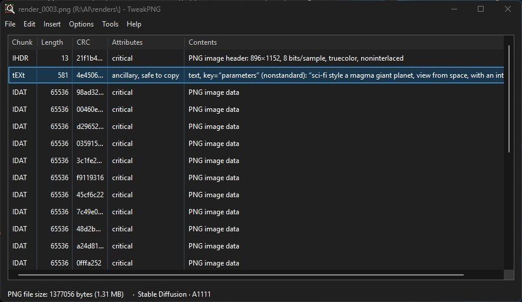
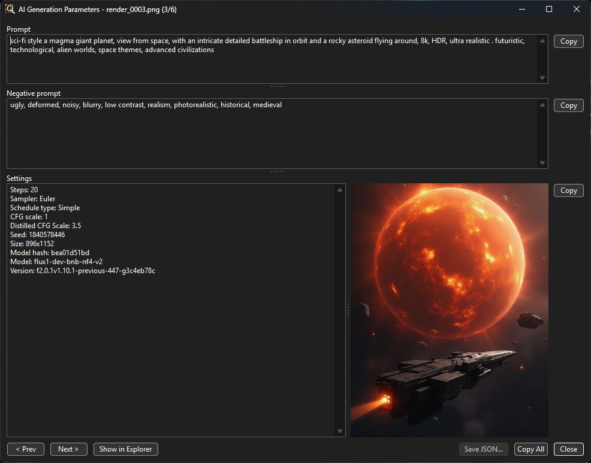
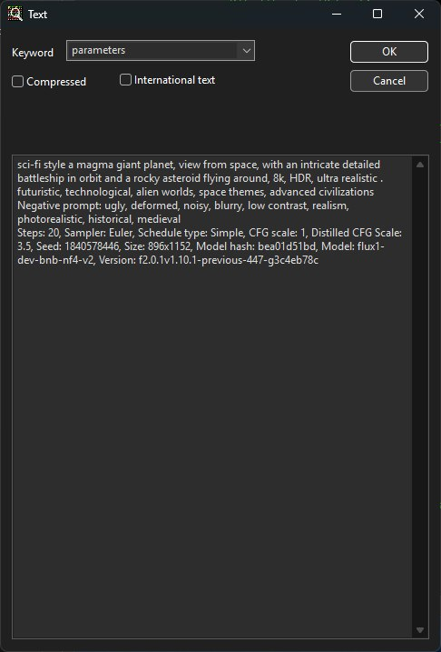

TweakPNG
========

A Windows application for viewing and editing the low-level chunk structure of PNG
image files.

This is a fork of [jsummers/tweakpng](https://github.com/jsummers/tweakpng)
([project homepage](https://entropymine.com/jason/tweakpng/)) by Jason Summers, with two
goals:

**Modern Windows 10/11 UI** — a dark-mode title bar, menu bar, chunk list, dialogs,
message boxes, and color picker, plus PerMonitorV2 DPI awareness, rounded corners, and a
Mica backdrop.

**Quality-of-life features for AI-generated images** (Automatic1111, ComfyUI, NovelAI,
Civitai):

- **Auto-open parameters** — opening an image that has AI generation parameters pops
  up a viewer automatically (toggle in Options → Preferences). Works for PNG
  (`parameters`/`prompt` tEXt chunks), JPEG/WebP (EXIF UserComment) and MP4/MOV videos
  (ComfyUI SaveVideo and VideoHelperSuite metadata).
- **AI Generation Parameters viewer** (Edit → View AI Parameters) — splits the metadata
  into Prompt, Negative prompt, and Settings, each with a Copy button (plus Copy All).
- **ComfyUI video workflows** - for MP4/MOV the settings also show the generation mode
  (reference/image/first-last frame/text to video) and the reference or first/last frame
  images that were used.
- **Browse a folder** - Prev/Next (or the arrow keys) in the viewer step through the
  images and videos in the same folder, and so does a left or right click on the thumbnail.
  Double-click the thumbnail for a full-screen view you can browse with the arrow keys or
  clicks, Esc to go back. Videos play right in the viewer and full screen (Play or Space,
  speed with - and + in steps of 25%). The borders between the prompt,
  negative prompt, settings and thumbnail can be dragged. **Show in Explorer** selects the
  file in Explorer, and **Save JSON** saves the ComfyUI graph so it can be loaded back into
  ComfyUI. Settings include LoRAs, and for videos the real size, frame count and duration.
- **Read AI parameters from File** (Tools menu) - one-shot file picker that opens the
  parsed viewer without loading the file as a document.
- **Folder Overview** (Tools menu, or Ctrl+F in the viewer) - all images and videos of a
  folder in one list with seed, model, mode, duration and prompt, a search box, and
  Export CSV. Scans in the background with a progress bar and keeps an index, so a folder
  with 22,000 files opens in well under a second the second time. The menu lists the
  folders that already have an index. Options > Folder
  Indexes shows the indexes and deletes the ones you no longer need.
- **Compare AI Parameters** (Tools menu) - shows what changed between two files: settings
  side by side and a word-level diff of the prompts.
- **Strip AI Metadata** (Edit menu) - removes prompt/seed/workflow/EXIF metadata so a file
  can be shared privately. PNG in place; JPEG, WebP and MP4/MOV as a cleaned copy.
- **Explorer menu** (Options > Preferences) - adds "View AI parameters" to the right-click
  menu of images and videos, which opens just the viewer.
- **Theme** (Options > Theme) - System default, Light or Dark, remembered between runs.
- **Generator badge** — the status bar identifies A1111, ComfyUI, or NovelAI images
  (for PNG and for JPEG/WebP/MP4/MOV files).

Download
--------

Grab the latest prebuilt 64-bit Windows binary from the
[**Releases**](https://github.com/JappeF/tweakpng/releases/latest) page — no installer,
just run `tweakpng.exe`.

Screenshots
-----------

The main chunk view with the modern dark UI:

The AI Generation Parameters viewer (prompt / negative prompt / settings, with copy
buttons):

Editing a chunk:

Building
--------

Open `proj/vs2022/tweakpng.sln` in Visual Studio 2022 and build the `Release`/`x64`
configuration (output: `Release64/tweakpng.exe`).

The default build links `libpng` and `zlib`, expected as sibling directories of the
repository root. To build without third-party libraries, comment out the feature flags
in `twpng-config.h`. See `tweakpng-src.txt` for the full build matrix, and `CLAUDE.md`
for repository structure, dark-mode implementation notes, and the AI-image features.

Documentation
-------------

For usage instructions, see `tweakpng.txt`.

Original project web site: [entropymine.com/jason/tweakpng](https://entropymine.com/jason/tweakpng/)

